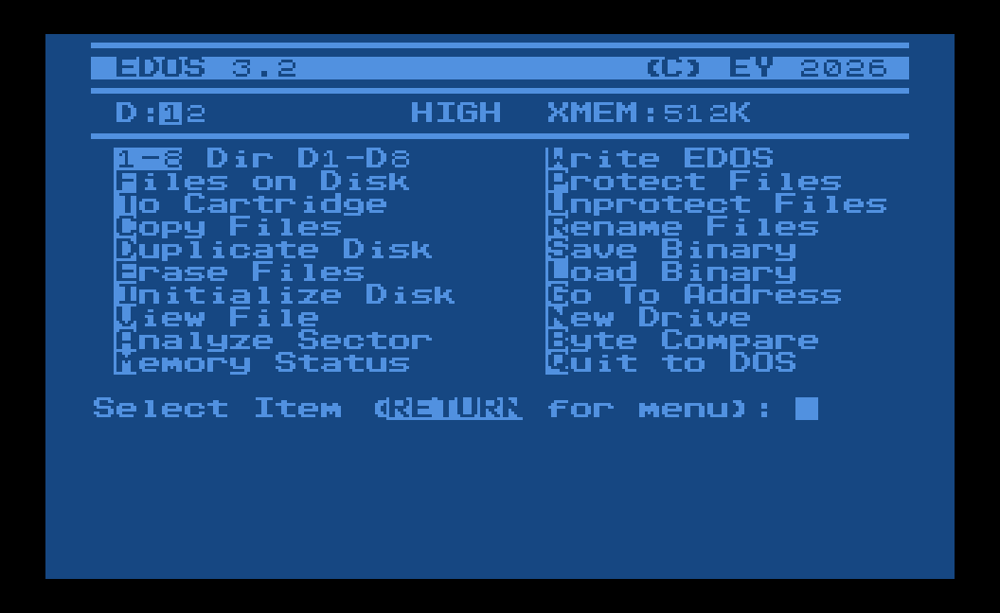

# EDOS


A menu-driven Disk Utility Package for Atari 8-bit computers, written in 6502 assembly with MAC/65,
running on top of MyDOS, SpartaDOS or DOS 2.5.

**Highlights**

- **Every disk job on one screen:** directory, copy, duplicate, erase, rename, protect, format,
  binary load and save, compare. Each is one key from the menu, with no external utilities to find
- **The same on any DOS:** EDOS works through CIO and SIO, not a DOS's own calls, so it looks and
  behaves alike on MyDOS, SpartaDOS and DOS 2.5
- **Big copies in one pass:** Copy Files and Duplicate Disk use the extended memory of an XL or XE
- **Fast disk copies:** when a drive has its own fast SIO code, Duplicate Disk reads it from the drive
  and uses it, whatever DOS you run
- **Colour shows what's happening:** green while reading, red before anything is written or erased
- **Sectors and memory too:** view any file, sector or memory address 128 bytes at a time; jump to
  an address or into the cartridge
- **Small:** `EDOS.COM` is 6,495 bytes
- **Assembles on the Atari:** the MAC/65 sources are on the disk; a PC cross assembler and tests are
  here too



## The commands

Press the key in inverse on the menu; **RETURN** shows the menu again. The status line at the top shows
the drives connected (the current one in inverse), **HIGH** when that drive runs at high speed, and the
extended memory (**XMEM**).

- **Dir D1-D8** (1 to 8) and **Files on Disk** (F): a two-column directory with the number of files
  and the free space. 1 to 8 list that drive whichever is current.
- **Copy Files** (C): copies one or more files from one disk to another. Name the files, then the
  target drive, or Y for the same drive and swap disks when asked. The copy goes through extended
  memory, so large files go in one pass.
- **Duplicate Disk** (D): copies a whole disk, sector by sector, through extended memory. Pick the
  source drive; once it is read, give the target drive or Y for the same one. EDOS checks whether the
  target disk is formatted and has the source's density, and formats it if it needs to.
- **Erase Files** (E), **Protect Files** (P), **Unprotect Files** (U), **Rename Files** (R): one or
  more files at a time, with wildcards.
- **Initialize Disk** (I): formats a disk in single, enhanced or double density.
- **View File** (V), **Analyze Sector** (A), **Memory Status** (M): one viewer, 128 bytes a screen.
  View File starts at a position you give in hex, Analyze Sector at a sector number in decimal, and
  Memory Status shows `MEMLO` and `MEMTOP`, then starts at a hex address. Sectors and memory go
  forwards (+) and backwards (-).
- **Load Binary** (L): asks whether to run the program, then loads it and runs it if you said so.
  A small loader in page 6 ($0600-$06FF) does the reading, so a program may load over EDOS
  itself. If it does, EDOS hands RESET back to DOS and you end up in DOS; otherwise you come
  back to the menu. Loading stops before anything is written to page 6.
- **Save Binary** (S): saves a memory range, with a run address.
- **Byte Compare** (B): tells you whether two files are the same.
- **Go To Address** (G): jumps to an address of one to four hex digits. **To Cartridge** (T): starts
  the cartridge, when there is one.
- **New Drive** (N): sets the current drive. Every command uses it unless you name another.
- **Write EDOS** (W): saves EDOS itself as `EDOS.COM` on the current drive.
- **Quit to DOS** (Q).

File names follow the usual DOS rules: `D2:GAME.COM`, `2:GAME.COM`, `GAME.COM`, `*.COM`, `G*.*` and
other wildcards. A drive number in the name works on that drive without changing the current one.

## Getting started

Download from **[Releases](../../releases/latest)**:

| File | What it is |
|---|---|
| `EDOS.ATR` | a bootable SpartaDOS 3.2 disk with EDOS, its font and the current MAC/65 sources |
| `EDOS.COM` | the program: a binary load file for any DOS |
| `EDOS.FNT` | EDOS's character set; keep it next to `EDOS.COM` |
| `EDOSTEST.ATR` | a bootable test disk with the test files and `TESTPLAN.TXT`, 35 checks for a real Atari |

1. Boot `EDOS.ATR` and type `EDOS` at the SpartaDOS prompt.
2. Or copy `EDOS.COM` and `EDOS.FNT` to your own DOS disk and load `EDOS.COM` (**L** in the DOS 2.5
   or MyDOS menu, `EDOS` at the SpartaDOS prompt). On DOS 2.5 and MyDOS, EDOS can also take the place
   of `DUP.SYS`.
3. Press **N** to pick your drive, then any command's key.

EDOS loads `EDOS.FNT` from the current drive when it starts. Without it, or without room for it above
$8000, EDOS keeps the Atari's own font. Any 1,024-byte Atari character set saved as `EDOS.FNT` works.

**Needs:** an Atari 400, 800, XL or XE with a disk drive, and MyDOS, SpartaDOS 3.x or DOS 2.5. Copy
Files and Duplicate Disk use 130XE-style extended memory when there is some.

## Building

```sh
pip install py65        # for the tests
tools/build.sh          # assembles, runs the tests and makes the disk images
```

| `tools/build.sh` writes | What it is |
|---|---|
| `build/EDOS.COM`, `EDOS.LST`, `EDOS.SYM` | the program, its listing and its symbols |
| `build/EDOS.FNT` | the font, made by `tools/font.py` from `EREZ.FNT`, one pixel to the right so inverse letters show as blocks |
| `build/EDOS.ATR` | the EDOS disk: SpartaDOS 3.2 and the utilities from `tools/disk/BASE.ATR`, with `EDOS.COM`, `EDOS.FNT` and the sources in MAC/65's tokenised form |
| `build/EDOSTEST.ATR` | the test disk |
| `build/EDOS-D2.ATR` | a DOS 2/MyDOS disk with `EDOS.COM` |
| `build/EDOS-BOOT.ATR` | a bootable DOS 2.5 or MyDOS disk with `EDOS.COM`, when you put that DOS's master disk at `tools/dos/DOS.ATR` (`EDOS_AS_DUP=1` also installs EDOS as `DUP.SYS`) |

`tools/mac65.py` is a Python cross assembler for the MAC/65 syntax used here. Fed the February 2025
sources, it makes the same `EDOS.COM` that MAC/65 made then, byte for byte. `build/` is what the build
writes; it is never committed.

**On the Atari**, with the sources from `EDOS.ATR` on D1:

```
LOAD #D:EDOS.M65
ASM ,,#D:EDOS.COM
```

`EDOS.M65` holds only the list of includes; MAC/65 reads the rest from disk as it assembles, which
leaves about 21K for the symbol table. Always give the object file: a plain `ASM` writes the program
into memory at $1E00, where MAC/65 keeps its own work area. `ASM #D:EDOS.M65,,#D:EDOS.COM` works on
DOS 2.5 and MyDOS but not on SpartaDOS: MAC/65 1.01 rewinds the main file for its second pass with a
POINT that SpartaDOS rejects, and stops with `ERROR -` and no number.

**Versions and releases.** The version is the one in the title bar (`TTL2` in `EDOSVARS.M65`). To
release: change it, add `release-notes/vX.Y.md`, commit and push, then run the Release workflow
(Actions > Release > Run workflow, on main) with version `X.Y`, or push a tag `vX.Y`. GitHub Actions
builds and tests, checks that EDOS shows that version, tags the commit and publishes `EDOS.COM`,
`EDOS.FNT`, `EDOS.ATR` and `EDOSTEST.ATR` as a GitHub Release with the notes. From then on, each push
to main that leaves `EDOS.COM` as released replaces that release's `EDOS.ATR` and `EDOSTEST.ATR` with
the new build, so the disk always carries the current sources; a changed program waits for the next
release. To try a fix on a real Atari, release it; if a release doesn't work, revert on main, release
the next number and say in the bad release's notes that it is withdrawn.

## Source

```
EDOS.M65       the main file, the one MAC/65 loads: options, origin and the includes
EDOSMAIN.M65   start-up, the menu and every command
EDOSVARS.M65   variables, the menu and the messages
UTILS.M65      general routines, usable in other programs (list below)
MACROS.M65     MAC/65 macros (list below)
SYSTEM.M65     OS and hardware addresses, zero page
CIOSTAT.M65    the texts for CIO error codes
tools/         cross assembler, tokenizer, ATR tools, font, screenshot, tests
release-notes/ what each release changed
```

`tools/mac65tok.py` converts between these text sources and MAC/65's tokenised SAVE format, checked
byte for byte against files MAC/65 saved. `tools/sparta.py` lists, extracts, adds, deletes and checks
files on SpartaDOS disk images; `tools/atr.py` does the same for DOS 2 and MyDOS images.
`tools/screenshot.py EDOS.png` draws the menu picture above by running `EDOS.COM` on the emulated 6502
(it needs Pillow).

**UTILS.M65**

| Routine | What it does |
|---|---|
| `DSPBIN`, `DRWHDR` | show up to 128 bytes, 8 a row, with their addresses; draw the header line |
| `DRAW` | draws a horizontal line in a special character |
| `RSTSCTCNT`, `INCSCTCNT` | reset and count up a four-digit decimal sector counter |
| `DTXMEM`, `BNK2DEC` | count the extended memory banks; show the count as text |
| `DTCDNS` | finds the density of the disk in a drive |
| `RESETFIO`, `READFIO` | forget the fast SIO code; read it from the drive into memory |
| `DOSIO`, `CALLSIO` | an SIO operation; the SIOV call, with the drive's fast SIO code when loaded |
| `WRTSCT` | writes one sector |
| `FXSCSZ` | sets the SIO sector size from the density and the sector number |
| `DOCIO`, `CLOSECHANNEL` | a CIO operation; close an IOCB |
| `DISKERR`, `GETERRTXT` | handle an error and show its message; the text for a CIO error code |
| `INLINE` | points `RETADR` at the parameters after a `JSR` and returns past them |
| `GETCHR`, `GETTEXT`, `GETINP1` | read a key; read a line of text; read a line into `INP1` |
| `GETADDR`, `INP2ADDR`, `A2HEX` | read an address; one to four hex digits in `INP1` to an address; one hex digit |
| `PRNTLN`, `PRNTDL`, `PRNTNL` | print text up to and with EOL; up to DEL; go down one line |
| `BIN2DEC` | `VALUE` to decimal text at A/Y: $FF → "255" |
| `DEC2HEX` | four decimal digits to a number: "1234" → $04D2 |
| `HEXOUT` | one byte to two hex digits at `FILE`,Y: $A0 → "A0" |
| `COPY`, `FILL` | copy text up to EOL; fill memory (used by `@CPYMEM` and `@FILLMEM`) |
| `HIDECURSOR`, `SHOWCURSOR`, `SETCOLRED` | hide and show the cursor; turn the border red |
| `LDFONT` | loads `EDOS.FNT` below the screen, or keeps the ROM font |

**MACROS.M65**

| Macro | What it does |
|---|---|
| `@CPYMEM` | copies one buffer to another (with two parameters: `JSR COPY`) |
| `@FILLMEM` | fills memory with a character (`JSR FILL`) |
| `@PRNTLN` | calls `PRNTLN` or `PRNTDL` |
| `@DRAW`, `@DOSIO`, `@DOCIO` | call `DRAW`, `DOSIO` and `DOCIO` with their parameters |
| `@CLOSEIO` | closes an IOCB |
| `@INPRM` | sets where text input goes |
| `@SETSCT` | sets the sector number for an operation |
| `@POINT2TXT` | points `INDPTR` at a buffer |
| `@CHECURPOS`, `@RSTCURPOS` | keep the cursor position on the stack; put it back |
| `@HIDCUR`, `@SHWCUR` | hide and show the cursor |
| `@HIDCHR`, `@SHWCHR` | carry out control characters, or show them as characters |
| `@COLGRN`, `@COLRED`, `@COLDEF` | border green, red, or black |
| `@MKCAPS` | turns caps lock on |
| `@MKASCII`, `@RMASCII` | a digit to ASCII and back |
| `@SIOSNDOFF`, `@SIOSNDON` | turn the SIO beeps off and on |

## Tests

The tests run the real `EDOS.COM` on an emulated 6502 ([py65](https://github.com/mnaberez/py65)) with
256K of banked memory, a simulated DOS (files on D1: and D2:), a simulated disk drive, and scripted
keys and lines:

```
tools/build.sh                     # runs them all
python3 tools/test_commands.py     # every menu command, the menu keys, start-up, RESET and the
                                   # exits (Quit, Cartridge, Go To): files written, memory loaded,
                                   # sectors copied, screen text and where control goes
python3 tools/test_edos.py         # routines: conversions, error texts, the disk copy loop in
                                   # every density, fast SIO loading, the memory layout
python3 tools/test_mac65tok.py     # the tokenizer, and the sources as MAC/65 needs them
python3 tools/test_sparta.py       # the disk images: files read back, fsck, the sources on the
                                   # disk assemble to EDOS.COM
python3 tools/difftest.py OLD NEW  # 29 command runs on two builds: any change in the screens,
                                   # CIO and SIO calls, files or memory
```

`difftest.py` is how every size reduction was checked to change nothing. GitHub Actions runs the build
and the tests on every push; only releases are published. On a real Atari, boot `EDOSTEST.ATR` and
follow `TESTPLAN.TXT` (`TYPE TESTPLAN.TXT`).

## The story behind it

I got my first Atari, a 600XL, in 1984, after afternoons at a friend's place programming his Atari
400. I taught myself assembly and wrote utilities and games, and spent hours in school lessons writing
assembly in my coding notebook.

A few years ago I came across that notebook again and found I had been writing my own Disk Utility
Package. I bought back an Atari setup, now a 1200XL with two 1050 drives, got a MAC/65 cartridge and
picked up my teenage project where I'd left it. EDOS is that project finished, with the functions I
missed in the others, and I use it on my Atari every day.

## Licence

EDOS is free software: you can redistribute it and/or modify it under
the terms of the GNU General Public License as published by the Free
Software Foundation, either version 2 of the License, or (at your option)
any later version. It is distributed in the hope that it will be useful,
but WITHOUT ANY WARRANTY; without even the implied warranty of
MERCHANTABILITY or FITNESS FOR A PARTICULAR PURPOSE. See [COPYING](COPYING).

Copyright (C) 2024-2026 AERA | Erez Yaary.

The disk images also carry SpartaDOS and the other DOS files they boot with; those stay under their
own authors' terms.

---

Part of **AERA** for Atari: [ECal](https://github.com/whomper/ECal) · [EContact](https://github.com/whomper/EContact) · [EMail](https://github.com/whomper/EMail) · [EFTP](https://github.com/whomper/EFTP) · [EHypView](https://github.com/whomper/EHypView) · [ClaudeST](https://github.com/whomper/ClaudeST) · 8-bit: [EDOS](https://github.com/whomper/EDOS) · [EFTP_XL](https://github.com/whomper/EFTP_XL)
